# bible-rs

A very fast, native Bible reader for the Mac, written in Rust. Just the Bible — beautifully
typeset, searchable as you type, with highlights, notes and bookmarks kept on your computer.

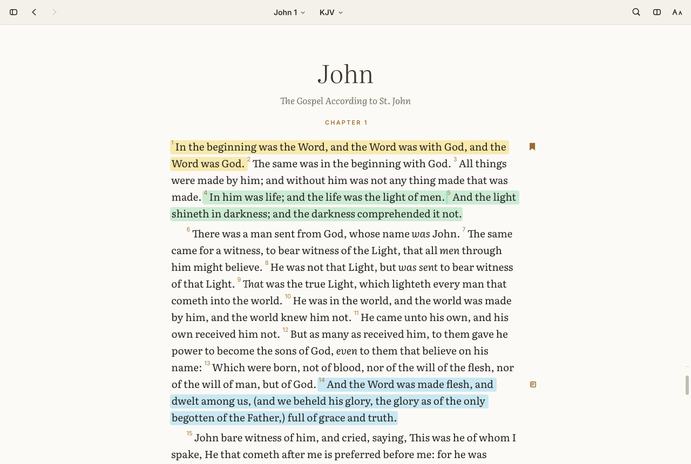

- **Instant.** The first frame already shows the text — about 15 ms of work on top of opening a
  window; full-text search across the whole Bible in under 2 ms (most queries well under 1 ms);
  scrolling costs ~0.2 ms of CPU per frame. [Numbers below.](#performance)
- **Typeset for reading.** Literata serif, a comfortable measure, superscript verse numbers,
  chapter and section headings, poetry with hanging indents, LORD in small capitals, optional red
  letters, paragraphs or verse-per-line, adjustable size, light / sepia / dark.
- **Seven public-domain translations built in** (KJV, WEB, BSB, ASV, YLT, Darby, Webster), side by
  side in parallel columns or one verse across all of them. Add the NLT and the NET Bible free in
  one click, the ESV with a free key, others with an API.Bible key or a file you own
  ([which translations, and how](TRANSLATIONS.md)).
- **Keyboard-first.** ⌘K jumps anywhere (`jn 3:16`, `Rom 8`, `1co13`, even `revalation 21`),
  ← → turn chapters, ⌘F searches, ⌘[ ⌘] go back and forward, 1–6 highlight.
- **Yours.** Highlights, notes and bookmarks live in a local SQLite file and export to JSON or
  Markdown. No accounts, no feeds, no network unless you add an online translation.

<table>
<tr>
<td>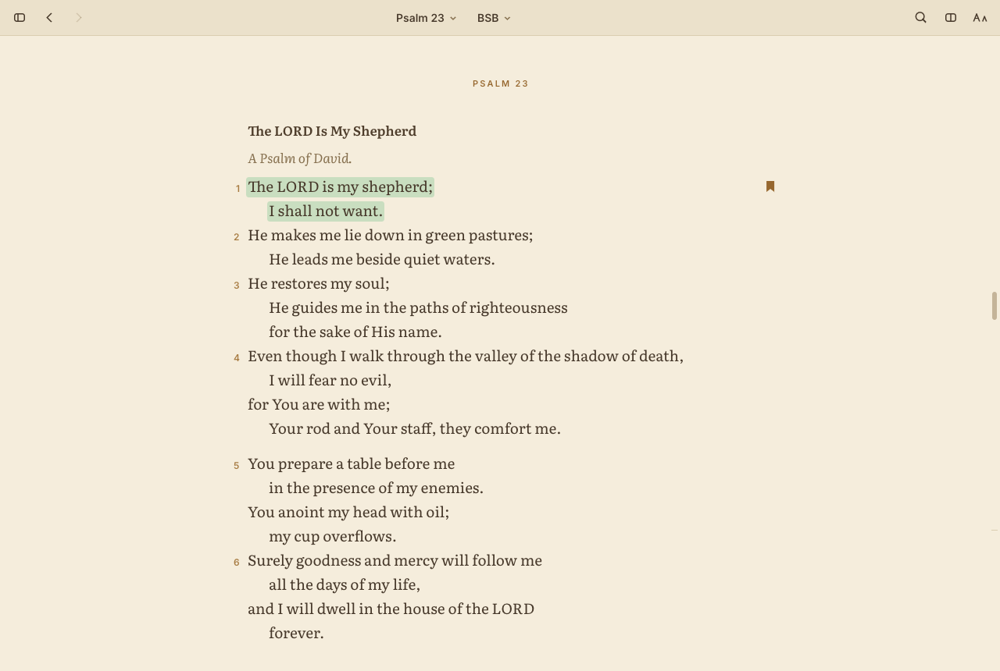</td>
<td>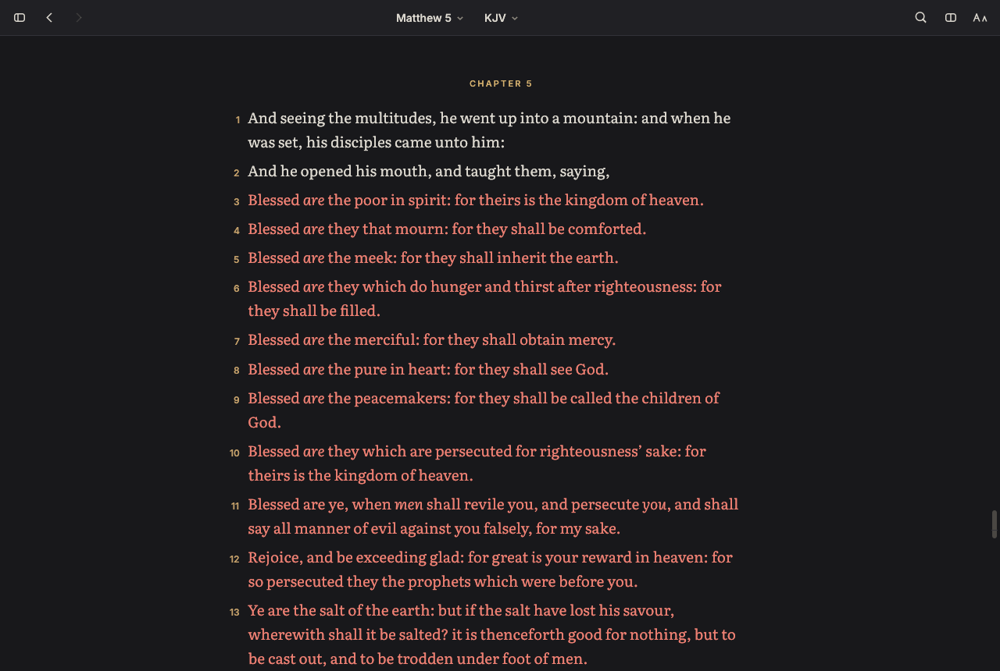</td>
</tr>
<tr>
<td>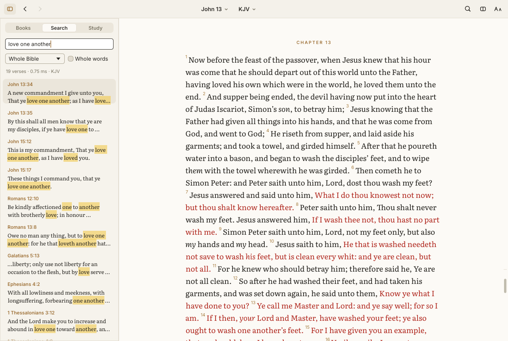</td>
<td>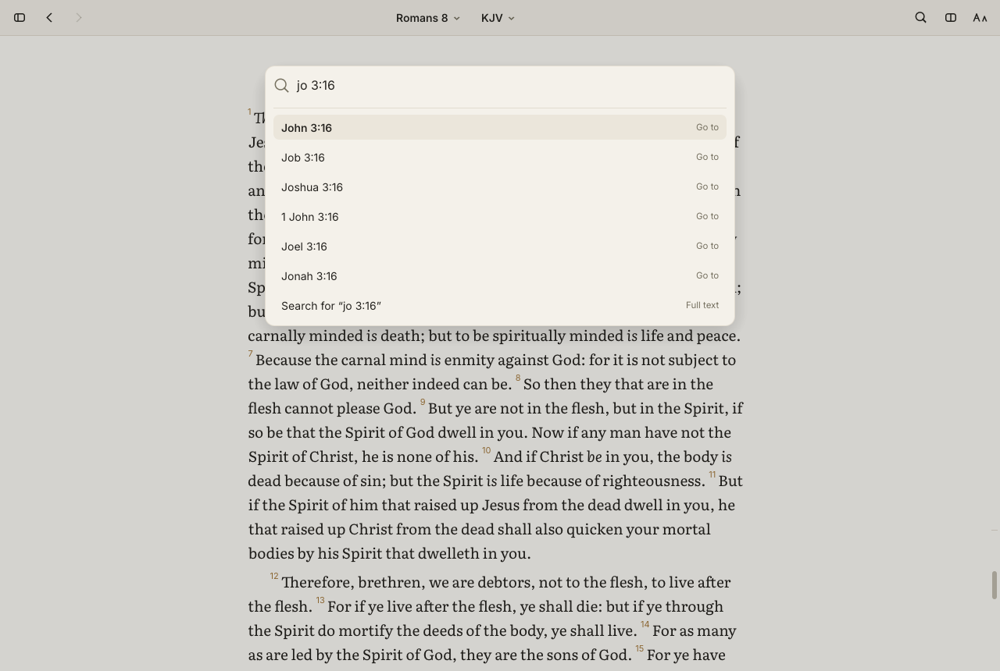</td>
</tr>
<tr>
<td>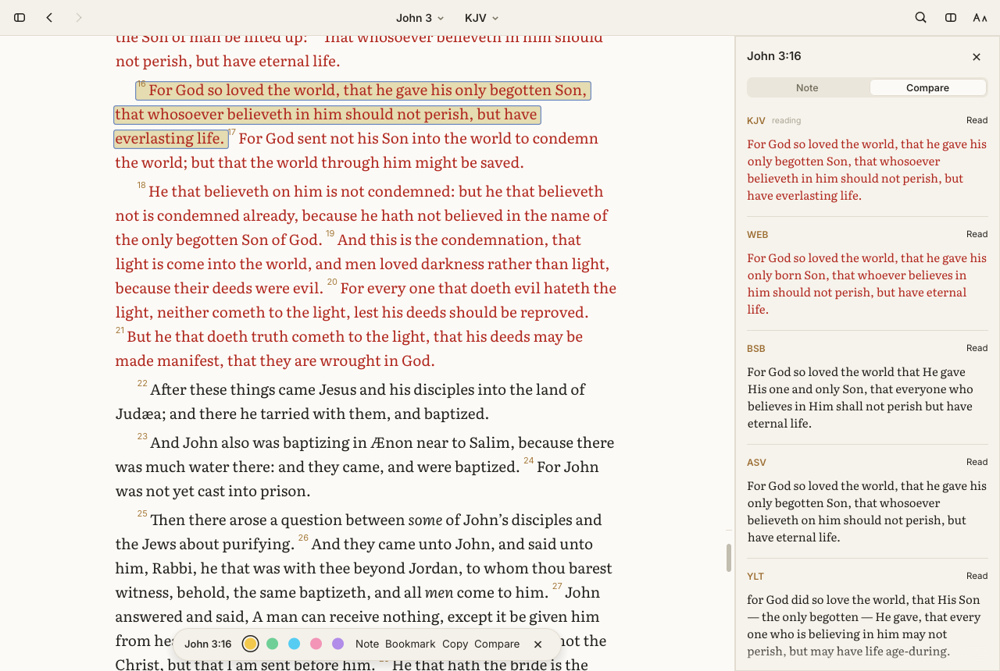</td>
<td>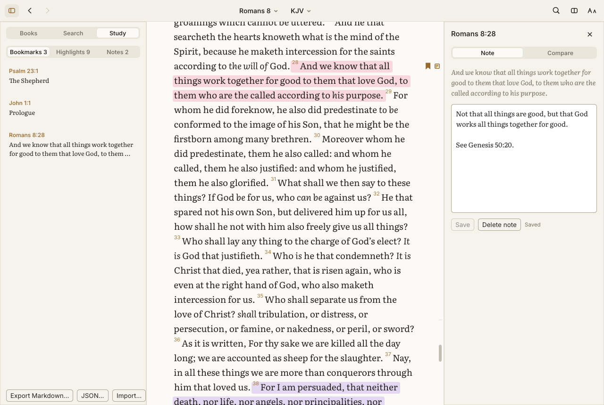</td>
</tr>
<tr>
<td>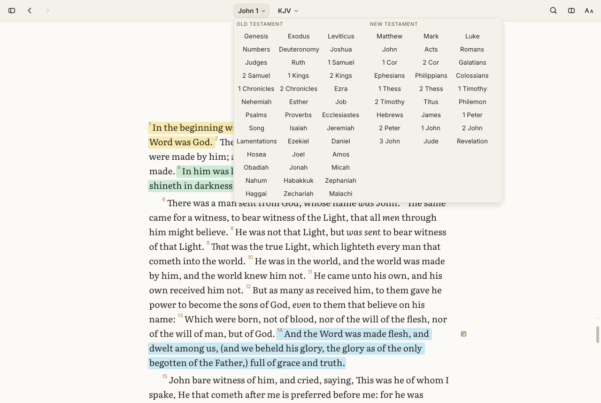</td>
<td>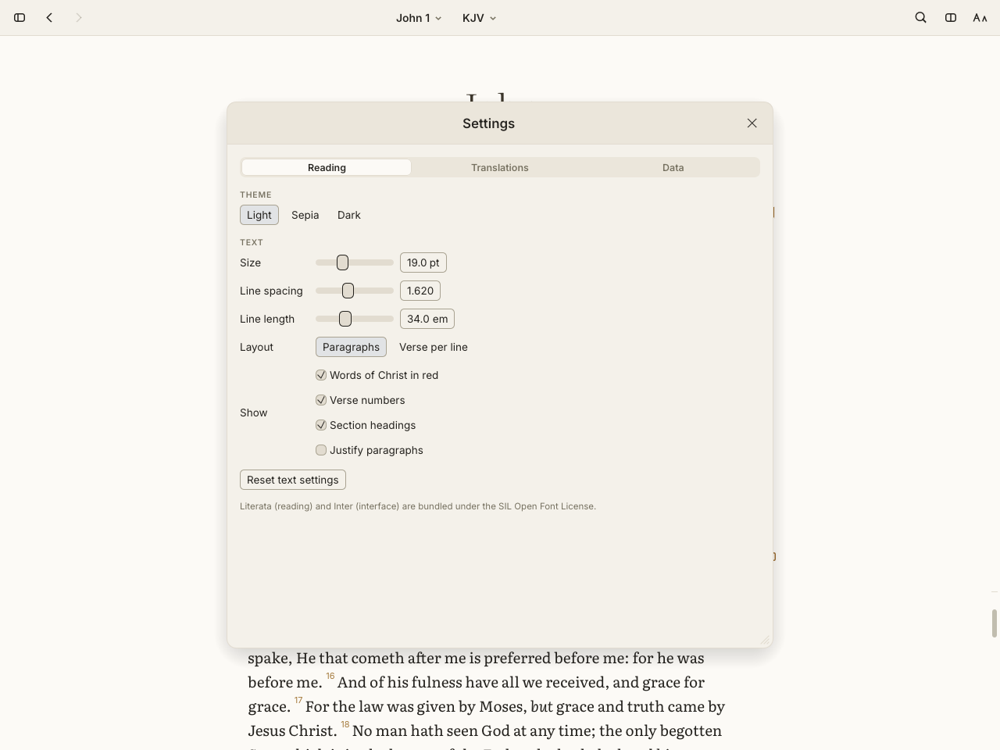</td>
</tr>
</table>

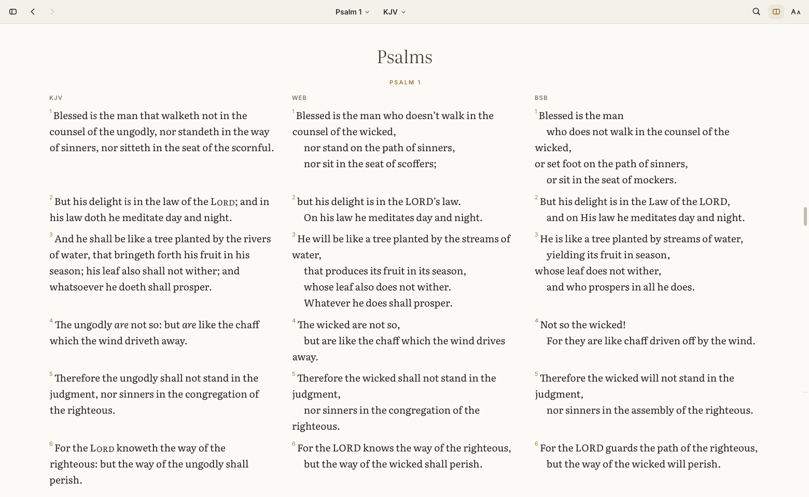

## Features

**Reading**
- Continuous scrolling through all 1,189 chapters — only what is on screen is ever typeset.
- Paragraph mode (verses flow inside paragraphs, first-line indents) or verse-per-line (numbers
  in the margin); poetry keeps its line structure in both.
- Book titles, chapter headings, section headings and Psalm superscriptions where the translation
  has them; words of Christ in red (⌘R); KJV translator additions in italics.
- Text size (⌘+ ⌘− ⌘0), line spacing, line length, justification, verse numbers and headings are
  all adjustable; light, sepia and dark themes (⌘⇧L).
- Remembers where you were.

**Navigation**
- ⌘K palette: references with fuzzy book names and typos, recent places, translations, commands.
- Book/chapter picker in the toolbar and the sidebar (⌘B).
- Back/forward history (⌘[ ⌘], ⌥← ⌥→), previous/next chapter (← →).

**Search** (⌘F)
- Results update as you type; every word must appear (word prefixes by default, or whole words).
- `"exact phrase"`, `-excluded` words, whole Bible / Old Testament / New Testament / one book.
- Matches highlighted in the results; ↑ ↓ and ⏎ jump to the verse, which flashes.

**Study**
- Click a verse (⇧-click for a range, J/K to move) to select it, then: highlight in six colours
  (1–6, 0 to clear), write a note (N), bookmark (B / ⌘D), copy (⌘C, or ⇧⌘C with the reference)
  or compare translations (C). Right-click opens the verse menu with all of these.
- Notes and bookmarks show in the margin; the Study sidebar lists everything.
- Export to Markdown (⌘E) or JSON (⌘⇧E); JSON imports back.

**Translations**
- Instant switching (⌘1…⌘9 or the toolbar), parallel columns (⌘⇧P) aligned verse by verse, and a
  compare view showing one verse in every installed translation.

**Mac**
- Native menu bar, unified title bar, Metal rendering on the low-power GPU, app icon,
  `scripts/bundle-macos.sh` → `.app` + `.dmg`.

## Translations

### Bundled — all public domain

| | Translation | Notes |
|---|---|---|
| KJV | King James Version (1769) | Red letters, italics for translator additions, small-caps LORD. Public domain except in the UK (Crown letters patent). |
| WEB | World English Bible | Modern English, red letters. Public domain; "World English Bible" is a trademark of eBible.org (text unaltered). |
| BSB | Berean Standard Bible | Modern English with section headings. Dedicated to the public domain in 2023. |
| ASV | American Standard Version (1901) | |
| YLT | Young's Literal Translation (1898) | |
| DBY | Darby Translation (1890) | |
| WBS | Webster Bible (1833) | |

All seven come from eBible.org's USFM editions; download URLs and SHA-256 digests are pinned in
[`xtask/src/main.rs`](xtask/src/main.rs) and the data is rebuilt with `cargo run -p xtask --
build-data`. Provenance, licence statements and what was deliberately left out are in
[`LICENSES/`](LICENSES/README.md).

**Copyrighted translations (NLT, NASB, LSB, ESV, NIV, …) are never part of this repository** —
no text, no derived index, no test fixtures. You can add them yourself in either of two ways.

### Import a translation you own

Settings (⌘,) → Translations → **Import file…** / **Import folder…** (or ⌘I), or from a terminal:

```sh
bible-rs import ~/Downloads/MyBible.zip --abbrev NASB --name "New American Standard Bible"
```

Supported formats:

| Format | What to point at |
|---|---|
| **USFM** | a `.usfm`/`.sfm` file, a folder of them, or a `.zip` |
| **OSIS XML** | the `.xml`/`.osis` file |
| **Zefania XML** | the `.xml` file |
| **SWORD module** | the module `.zip`, its unpacked folder, or its `mods.d/*.conf` file. zText/RawText drivers in KJV, KJVA, NRSV or NRSVA versification; OSIS, ThML and GBF markup. **Locked modules** (e.g. purchased from a publisher) work with your unlock key: enter it in the *SWORD unlock key* field (or `--key`). |

The text is converted to bible-rs's format and stored only in your data folder
(`~/Library/Application Support/bible-rs/translations/` on macOS). Deuterocanonical books are
skipped. Remove an import from the same settings page or with `bible-rs remove <id>`.

### Online translations

Chapters are fetched from each publisher's own API as you read, and shown with the publisher's
notice (which links to their site, as their terms ask). [TRANSLATIONS.md](TRANSLATIONS.md) covers
every major modern translation: how to get it free, or why it has to be bought.

| Service | Translations | Key |
|---|---|---|
| **NLT API** (Tyndale) | New Living Translation | None needed. An optional free key from <https://api.nlt.to/> raises the limits |
| **NET Bible API** (bible.org) | NET Bible | None needed |
| **ESV API** (Crossway) | English Standard Version | Free for non-commercial use: <https://api.esv.org/> |
| **API.Bible** (American Bible Society) | Whatever your plan and the publishers allow, e.g. NASB, NKJV, CSB, AMP | <https://api.bible/> |

1. Settings (⌘,) → Translations → **Online translations**.
2. NLT and NET: click **Add NLT** or **Add NET**. ESV: **Get Free Key…** opens api.esv.org; paste
   the key and click **Add ESV**. API.Bible: paste your key, click **List My Bibles…**, and **Add**
   the ones you want. Keys are stored in the **macOS Keychain** (on Linux, a `secrets.json` that
   only you can read).
3. Pick the translation like any other, alone or in parallel columns.

What is stored locally follows each API's terms:

- **NLT API.** 50 verses a request and 500 requests a day without a key (500 and 5,000 with
  one). Longer chapters are fetched in several ranges, requests are spaced at least a second apart,
  and the day's count is kept so the limit is never passed. At most 500 verses are kept on disk,
  and never a complete book.
- **NET Bible API.** Requests are spaced at least a second apart. The NET's terms set no storage
  limit, so fetched chapters are kept for 30 days.
- **ESV API.** At most 500 verses and never more than half of any book are kept on disk. The
  oldest chapters go first, and a one-chapter book is shown but not stored. Requests are spaced at
  least a second apart (the limit is 60 a minute).
- **API.Bible.** Fewer than 500 consecutive verses are cached, and nothing older than 14 days is
  used. The copyright returned with each chapter is shown with API.Bible's citation, and each
  displayed chapter is reported through API.Bible's Fair Use Management System (FUMS) with an
  anonymous device id.

Full-text search covers local translations (bundled and imported). Online translations are read
chapter by chapter, and appear in parallel and compare views as their chapters load.

## Keyboard shortcuts

| | |
|---|---|
| ⌘K | Jump to a reference, translation or command |
| ⌘F or / | Search |
| ← / → | Previous / next chapter |
| ↑ ↓, Space, ⇧Space, PgUp/PgDn | Scroll |
| ⌘[ / ⌘] (⌥← / ⌥→) | Back / forward |
| Click, ⇧-click, J / K | Select a verse, a range, next / previous verse |
| 1–6, 0 | Highlight colour, remove highlight |
| N · B or ⌘D · ⌘C · ⇧⌘C · C | Note · bookmark · copy · copy with reference · compare |
| ⌘1…⌘9 | Switch translation |
| ⌘⇧P | Parallel translations |
| ⌘L · ⌘R · ⌘⇧L | Verse-per-line · red letters · theme |
| ⌘+ ⌘− ⌘0 · ⌘T | Text size · text & layout |
| ⌃⌘F | Focus mode |
| ⌘B · ⌘, · ⌘/ | Sidebar · settings · shortcut help |
| ⌘E · ⌘⇧E · ⌘I | Export Markdown · export JSON · import translation |

⌘/ shows them in the app:

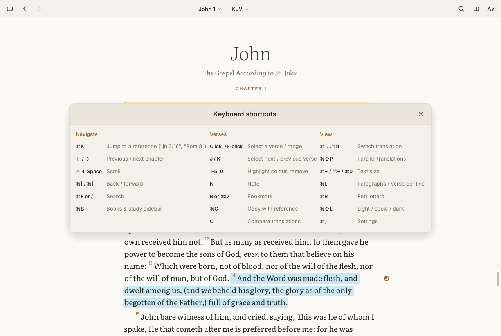

## Performance

Measured on the machine bible-rs was built on: a headless Ubuntu VPS (AMD EPYC 7B13, 16 vCPUs)
with **no GPU** — the app runs under Xvfb with Mesa's llvmpipe software OpenGL, so window and frame
timings are pessimistic compared with a Mac. Criterion medians (`cargo bench`); startup is the
median of 15 launches (`scripts/bench-startup.sh`). macOS numbers from CI are [further
down](#on-macos).

**Startup** — target: first painted text in under 150 ms

| | Median |
|---|---|
| bible-rs: launch → first frame built (chapter typeset, ready to draw) | 118 ms |
| bible-rs: launch → first frame presented on screen | 162 ms |
| Empty eframe window with the same options (the platform floor): built / presented | 104 ms / 146 ms |
| **bible-rs's own cost on top of the floor** | **≈ 15 ms** |

The first frame always contains the text. While the window and OpenGL context are created
(~100 ms here, almost all of it software GL), the translation being read is decoded on a
background thread (~25 ms; its search corpus is built later, after the first frame); frame 0 then
typesets the visible chapter (2–7 ms). Under software rendering the empty-window
floor alone is 146 ms, so presentation lands just over the target here; the app's own work fits
in ~15 ms.

**Search** — target: under 10 ms. KJV, 31,102 verses, whole Bible unless noted.

| Query | Time |
|---|---|
| `the` (a very common word — 27,435 verses) | 1.79 ms |
| `lov` (word prefix) | 0.20 ms |
| `melchizedek` | 0.15 ms |
| `love one another` | 0.28 ms |
| `"in the beginning"` (phrase) | 0.15 ms |
| `"jesus wept"` (phrase) | 0.16 ms |
| `light -darkness` (exclusion) | 0.28 ms |
| `faith`, New Testament only | 0.055 ms |
| `shepherd`, Psalms only | 0.008 ms |
| Building a translation's search corpus (once, on a background thread after the first frame) | 33 ms |

**Scrolling** — target: 60 fps or better. 900 frames scripted at ~2,200 px/s through 13
consecutive chapters:

| | Mean | p50 | p95 | p99 | Max |
|---|---|---|---|---|---|
| App work per frame (layout, underlays, tessellation input) | 0.18 ms | 0.12 ms | 0.22 ms | 3.1 ms | 4.7 ms |
| Frame interval (software rendering of the whole window) | 6.5 ms | 6.3 ms | 8.4 ms | | |

The p99 frames are the ones where a new chapter scrolls into view and is typeset; even those stay
well inside a 120 Hz frame (8.3 ms). Chapters next to the reading position are typeset while idle.

**Typesetting one chapter** (uncached, default settings):

| Chapter | Time |
|---|---|
| John 3, paragraphs (36 verses) | 1.95 ms |
| Genesis 1 (31 verses) | 2.14 ms |
| Psalm 23 (poetry) | 0.28 ms |
| Psalm 119 (176 verses, the longest chapter) | 8.6 ms |
| John 3, verse per line | 1.91 ms |
| John 3, KJV + WEB in parallel columns | 4.25 ms |

**Everything else**

| | Time |
|---|---|
| Decode the KJV (`.bbl` → in-memory model) | 17.7 ms |
| Read the metadata of all 7 bundled translations | 0.13 ms |
| Parse `1co13:4-7` | 1.3 µs |
| Suggest `revalation 21` (fuzzy book name with a typo) | 92 µs |
| Open the SQLite study store | 0.36 ms |

### On macOS

The macOS CI job runs the same probes against the bundled app with both renderers. GitHub's
`macos-latest` runner is a virtual machine with a paravirtualized GPU and display, so absolute
window timings are far slower than a real Mac and vary a lot between runs; compare each column with
the empty-window baseline measured alongside it. Medians of 10 launches:

| | Metal (default) | OpenGL |
|---|---|---|
| bible-rs: first frame built | 237 ms | 194 ms |
| bible-rs: first frame presented | **253 ms** | 325 ms |
| Empty eframe window, same renderer: first frame presented | 268 ms | 236 ms |
| Scrolling: frame interval (mean) | **16.8 ms — 60 fps, the display's rate** | 66.6 ms — 15 fps |
| Scrolling: app work per frame (mean / p99) | 0.16 / 3.0 ms | 0.13 / 2.2 ms |

Startup trace for the Metal build on that runner: window and Metal context ready at 207 ms, first
frame built at 218 ms — **bible-rs's own work before the first paint is ~11 ms** (John 1 typeset
in 4.3 ms); everything before that is the machine creating a window. OpenGL's 15 fps while
scrolling is why macOS renders with Metal. Final numbers on real Mac hardware are still to be
taken; `scripts/bench-startup.sh` measures them, including the empty-window floor.

**Sidebar.** Opening and closing the sidebar slides it on a spring that comes to rest in 265 ms.
At the default width the text column keeps its measure and only moves; narrower windows reflow the
chapter on screen once per frame. On a MacBook Pro (M4 Pro, 120 Hz built-in display), 8 slides per
scenario with `scripts/bench-sidebar.sh`:

| Window | Chapters typeset per slide | UI time per frame, p95 | Frame interval, median |
|---|---|---|---|
| 1280 × 800, one column or parallel | 0 | 0.5 ms | 8.4 ms |
| 720 × 800 (compact) | 26 | 3.9 ms | 8.4 ms |
| 720 × 800, Psalm 119 (the longest chapter) | 27 | 5.4 ms | 8.3 ms |

Reproduce with:

```sh
cargo bench -p bible-core          # search, decoding, references, SQLite
cargo bench -p bible-rs            # chapter typesetting
scripts/bench-startup.sh           # launch → first frame (vs. an empty window), 900-frame scroll run
scripts/bench-sidebar.sh           # sidebar open/close: frame pacing, UI time, chapters typeset per slide
bible-rs search "love one another" # prints the query time
```

## Building

Requires Rust 1.95+, the minimum egui 0.36 supports.

```sh
# Linux needs: libxkbcommon-dev libgl1-mesa-dev libwayland-dev libx11-dev
cargo build --release
./target/release/bible-rs
```

On macOS, `scripts/bundle-macos.sh` builds `dist/bible-rs.app` and `dist/bible-rs-<version>.dmg`
(`UNIVERSAL=1` for arm64 + x86_64, `SIGN_IDENTITY=…` to sign). CI builds the DMG on every push
and uploads it as an artifact.

Other tasks:

| | |
|---|---|
| `cargo test --workspace` | core (model, format, importers, search, references, study, online with a mock server) and typesetting tests |
| `cargo run -p xtask -- build-data` | re-download the pinned public-domain sources and regenerate `data/translations/*.bbl` |
| `scripts/screenshots.sh` | regenerate `docs/screenshots/` under Xvfb |
| `BIBLE_RS_HOME=/some/dir bible-rs` | use another data folder |

The binary doubles as a small CLI:

```sh
bible-rs read "jn 3:16-18" --translation web
bible-rs search '"in the beginning"' --scope nt
bible-rs list
bible-rs import path/to/module.zip [--abbrev X --name "…" --key UNLOCK]
bible-rs export --markdown -o notes.md
bible-rs import-notes notes.json
```

## How it's built

```
crates/core   bible-core: canonical book grid, verse-indexed model, .bbl format, USFM/OSIS/
              Zefania/SWORD importers, search, reference parsing, SQLite study store,
              ESV/API.Bible providers, Keychain secrets, translation library
crates/app    bible-rs: egui app — reader (typesetting, continuous scroll), sidebar, palette,
              panels, settings, macOS menu bar, CLI
xtask         reproducible bundled-data build from pinned public-domain sources
data          generated .bbl files (public domain only)
```

See [DECISIONS.md](DECISIONS.md) for why egui, how typesetting and continuous scrolling work, the
data format, search, and the licensing approach.

## License

Code: MIT ([LICENSE](LICENSE)). Bundled translations: public domain ([LICENSES/](LICENSES/README.md)).
Fonts: Literata and Inter, SIL Open Font License 1.1.
